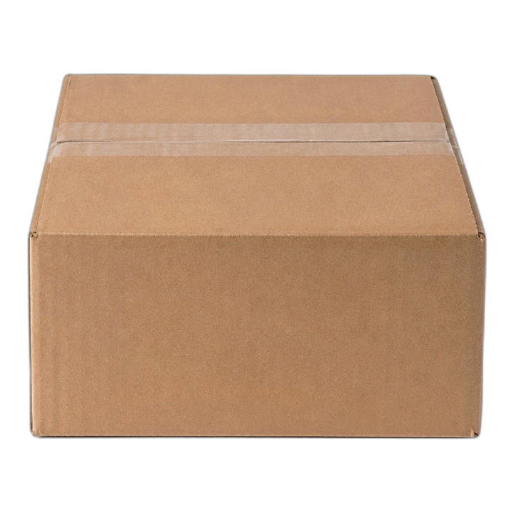
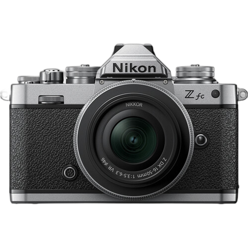
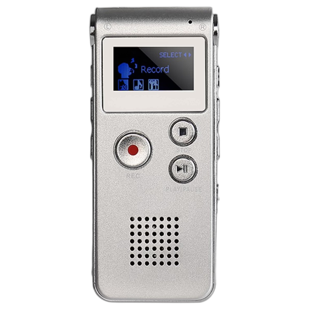
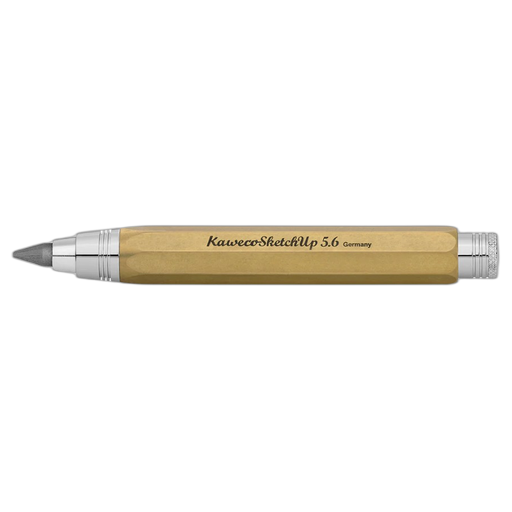
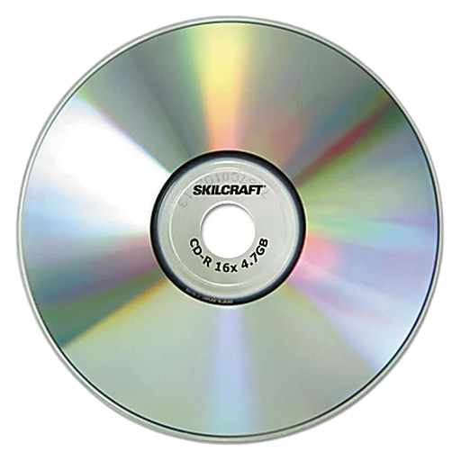
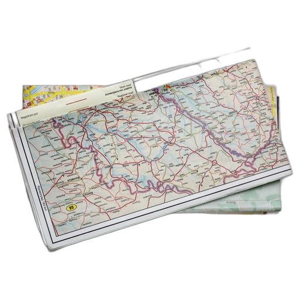
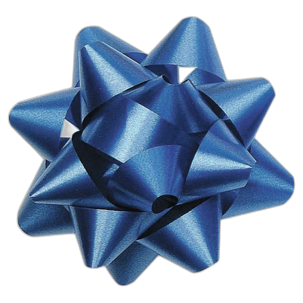

<div align="center">

  

  # 📦 A Little Box of Goodies
  ### A Nostalgic, Aesthetic Digital Care Package Creator

  [](https://render.com)
  [](https://nodejs.org)
  [](https://expressjs.com)
  [](https://vercel.com)
  [](LICENSE)

  <p align="center">
    <b>Send heartfelt letters, voice notes, doodles, songs, and memory tokens to your favorite person.</b><br />
    <i>100% Free • No Sign-up Required • Vintage Postal & Receipt Paper Aesthetic</i>
  </p>

  <p align="center">
    <a href="#-features">Features</a> •
    <a href="#-the-10-digital-goodies">The Goodies</a> •
    <a href="#-interactive-unboxing">Unboxing Experience</a> •
    <a href="#-tech-stack">Tech Stack</a> •
    <a href="#-quickstart">Quickstart</a> •
    <a href="#-api-reference">API</a> •
    <a href="#-deployment">Deployment</a>
  </p>

</div>

---

## 📖 About the Project

**A Little Box of Goodies** transforms ordinary digital messaging into a warm, tactile parcel experience. Inspired by vintage grocery receipts, postal stamps, and courier shipping labels, the app lets you tuck custom gifts, doodles, voice memos, and love notes into a virtual parcel.

Once sealed, you receive a shareable link (`/p/:id`). When your recipient taps open their box, it reveals a physics-scattered collection of cards with gentle floating animations.

### 🌟 Key Highlights
- **100% Free & No Paywalls**: Built purely for the joy of gifting with zero friction.
- **No Sign-Up or Account Needed**: Open the app, compose your package, and get your link instantly.
- **Live Voice Recorder & Canvas Sketchpad**: Record voice memos directly from your browser or draw doodles on an integrated HTML5 canvas.
- **Optimized for Mobile & Desktop**: Fully responsive with custom touch interactions, responsive card layouts, and lightweight memory handling.
- **Dual Cloud Ready**: Seamlessly runs on persistent containers like **Render** or serverless environments like **Vercel**.

---

## 🎁 The 10 Digital Goodies

You can pack your parcel with any combination of 10 handcrafted items:

| Icon | Item | Description |
| :---: | :--- | :--- |
|  | **Love Notes** | Sincere personal letters formatted with elegant Cormorant Garamond serif typography. |
|  | **Polaroid Photos** | Upload your favorite snapshot. Automatically compressed client-side to keep load times instantaneous. |
|  | **Voice Memos** | Record audio messages live from your microphone using the web `MediaRecorder` API or upload audio clips. |
|  | **Canvas Doodle** | An interactive canvas drawing pad with color swatches, adjustable stroke weights, and undo/redo. |
|  | **Custom Coupons** | Redeemable tokens (*"One free warm coffee date"*, *"A pass on washing dishes"*, *"1x tight hug"*). |
|  | **Song / Mixtape** | Dedicated song recommendations with direct streaming links (YouTube / Spotify). |
|  | **Video Clip** | Video memories or favorite clips embedded neatly into an unboxing card. |
|  | **Location Pin** | Pin a memorable spot (where you first met, a favorite cafe, a dream destination). |
|  | **Surprise Gift** | An external gift link, book wish list, or voucher wrapped in gift styling. |
|  | **News & Clippings** | Curated headlines, milestones, shared jokes, or celebratory announcements. |

---

## ✨ The Interactive Unboxing Experience

```
       [ Sealed Parcel ]
              │
              ▼  (Tap to Open)
  ┌────────────────────────────────────────┐
  │         3D Box Opening Animation       │
  └────────────────────────────────────────┘
              │
              ▼
   (Floating Scattered Floaties)
  ┌────────┐   ┌────────┐   ┌────────┐
  │ Note   │   │ Photo  │   │ Voice  │
  └────────┘   └────────┘   └────────┘
  ┌────────┐   ┌────────┐   ┌────────┐
  │ Coupon │   │ Doodle │   │ Song   │
  └────────┘   └────────┘   └────────┘
              │
              ▼
  [ Read Receipts: openedAt Timestamp ]
```

1. **Custom Parcel Label**: The recipient receives a parcel addressed specifically to them (`To: [name] / From: [name]`).
2. **Interactive Unboxing**: Tapping the box triggers an unboxing sound and fluid CSS unfolding sequence.
3. **Floating Card Scatter**: All tucked goodies drift gently on screen with customizable viewing modals.
4. **Opened Tracking**: Senders can verify when their parcel was opened thanks to the automated `openedAt` status webhook.

---

## 🛠️ Tech Stack & Architecture

### **Frontend**
- **Vanilla JavaScript (ES6+)**: Zero framework bloat; fast DOM manipulation and event delegation.
- **Custom CSS3**: Modular stylesheets with CSS variables, paper-grain textures, custom drop-shadows, and keyframe float animations.
- **HTML5 Canvas & Web Audio**: In-browser drawing sketchpad and real-time audio capture via `MediaRecorder`.
- **Google Fonts**: `Cormorant Garamond`, `Space Mono`, and `Great Vibes`.

### **Backend & Storage**
- **Node.js & Express.js**: REST API handling parcel serialization, asset serving, and delivery routes.
- **Multer**: Secure multipart media upload pipeline with size limits and file-type validation.
- **JSON File Store**: Portable, configuration-free storage in `data/packages.json`.
- **Hybrid Cloud Compatibility**:
  - **Render & Local**: Uses persistent disk paths (`./data` and `./uploads`).
  - **Vercel**: Automatically delegates to `/tmp` storage with fallback syncing to bundled repository data.

---

## 🚀 Quickstart & Local Setup

### Prerequisites
- [Node.js](https://nodejs.org/) (v18.0.0 or higher recommended)
- `npm` (comes bundled with Node.js)

### 1. Clone the Repository
```bash
git clone https://github.com/DhaneshUdayPujare/gift-project.git
cd gift-project
```

### 2. Install Dependencies
```bash
npm install
```

### 3. Start the Server
```bash
# Production mode
npm start

# Or with Node watch mode (auto-reload on edit)
npm run dev
```

### 4. Open in Browser
Visit **`http://localhost:3000`** in your browser.

---

## 📂 Project Structure

```text
gift_project/
├── data/
│   └── packages.json          # Persisted care packages database
├── public/
│   ├── assets/                # Stamps, paper textures, icons, & box graphics
│   │   ├── care-package-box.webp
│   │   ├── shipping-label.webp
│   │   ├── stamp-goodies.webp
│   │   ├── stamp-share.webp
│   │   ├── stamp-tuck.webp
│   │   └── ... (goodie icons)
│   ├── app.js                 # Core client application & state management
│   ├── styles.css             # Vintage paper & receipt styling
│   ├── index.html             # Single Page Application container
│   └── favicon.ico
├── uploads/                   # Stored user-uploaded media (photos, voice notes)
├── .gitignore
├── package.json               # Dependencies and launch scripts
├── server.js                  # Express backend & API endpoints
├── vercel.json                # Vercel serverless deployment config
└── README.md                  # Project documentation
```

---

## 🔌 REST API Reference

| Method | Endpoint | Description |
| :--- | :--- | :--- |
| `POST` | `/api/upload` | Uploads an image or voice recording file (multipart form data). Returns `{ fileUrl }`. |
| `POST` | `/api/packages` | Creates a new parcel. Payload includes `title`, `from`, `message`, `items`, and `theme`. Returns `{ id, url }`. |
| `GET` | `/api/packages/:id` | Fetches package contents and increments the view counter. |
| `POST` | `/api/packages/:id/opened` | Marks the package as opened and sets the `openedAt` timestamp. |
| `GET` | `/p/:id` | Recipient route; serves the unboxing experience for the specified parcel ID. |

---

## ☁️ Deployment

### 1. Deploying on Render (Recommended for Persistence)
This project is live and production-ready on **Render**:
1. Connect your GitHub repository to [Render](https://render.com).
2. Choose **Web Service**.
3. Configure the service settings:
   - **Environment**: `Node`
   - **Build Command**: `npm install`
   - **Start Command**: `node server.js`
4. *(Optional for persistence)*: Attach a Render Persistent Disk mounted to `/data` and `/uploads`.

### 2. Deploying on Vercel
The repository includes a ready-to-deploy [`vercel.json`](vercel.json):
```bash
npm i -g vercel
vercel
```
`server.js` automatically detects `process.env.VERCEL` and configures serverless `/tmp` directories with bundled package data fallback.

---

## 🛡️ Privacy & Performance

- **Zero Trackers**: No third-party tracking scripts, analytics cookies, or behavioral advertising.
- **Client-Side Optimization**: Photos uploaded from high-resolution mobile phones are resized inside a client-side canvas before uploading to conserve bandwidth and prevent memory pressure.
- **Strict Limits**: Audio and photo uploads are capped at 15MB with sanitized file names to maintain filesystem integrity.

---

## 🤝 Contributing

Contributions, feedback, and ideas are warmly welcomed!
1. **Fork** the repository
2. **Create** your feature branch (`git checkout -b feature/NewGoodieType`)
3. **Commit** your changes (`git commit -m "feat: add animated confetti goodie"`)
4. **Push** to the branch (`git push origin feature/NewGoodieType`)
5. **Open** a Pull Request

---

## 📄 License

Distributed under the **MIT License**. See `LICENSE` for more information.

---

<div align="center">
  Crafted with care by <b><a href="https://github.com/DhaneshUdayPujare">Dhanesh Uday Pujare</a></b><br />
  <i>"A little box of goodies, delivered with love."</i>
</div>
